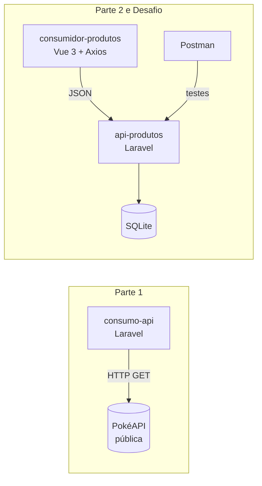

<div align="center">

# 🚀 Atividade Básica de API

**Consumo de API pública • API RESTful com Laravel • Service & Testes • Projeto consumidor em Vue**


</div>

---

## 📑 Sumário

- [📌 Sobre o projeto](#-sobre-o-projeto)
- [🧩 Arquitetura](#-arquitetura)
- [📂 Estrutura do repositório](#-estrutura-do-repositório)
- [🛠️ Tecnologias](#️-tecnologias)
- [⚡ Início rápido](#-início-rápido)
- [🔌 Parte 1: Consumo da PokéAPI](#-parte-1-consumo-da-pokéapi)
- [📦 Parte 2: API de Produtos](#-parte-2-api-de-produtos)
- [🧪 Testes com Postman](#-testes-com-postman)
- [🎯 Desafio: Consumidor em Vue](#-desafio-consumidor-em-vue)
- [🧱 Service e Testes](#-service-e-testes)
- [✅ Checklist da atividade](#-checklist-da-atividade)
- [👨‍💻 Autor](#-autor)

---

## 📌 Sobre o projeto

Atividade prática de **APIs** dividida em três entregas, mais a atividade de **Service e Testes** aplicada sobre a API de produtos:

| # | Entrega | O que foi feito | Stack |
|:-:|---|---|---|
| 1️⃣ | **Consumo de API** | Consumo da [PokéAPI](https://pokeapi.co/) (gratuita, sem chave) | Laravel + `Http` facade |
| 2️⃣ | **Criação de API** | CRUD de produtos com **rotas RESTful**, **Resource** e **testes no Postman** | Laravel + SQLite |
| 3️⃣ | **Desafio** | Outro projeto, em outro framework, consumindo a API criada | Vue 3 + Vite + Axios |
| 4️⃣ | **Service e Testes** | Método `update` no service e testes automatizados da regra de negócio | Laravel + PHPUnit |

---

## 🧩 Arquitetura



---

## 📂 Estrutura do repositório

```bash
AtividadeAPI/
├── 📁 consumo-api/                 # Parte 1: Laravel consumindo a PokéAPI
│   ├── app/Http/Controllers/
│   │   └── PokemonController.php
│   └── routes/web.php
│
├── 📁 api-produtos/                # Parte 2: API RESTful de produtos
│   ├── app/
│   │   ├── Models/Produto.php
│   │   ├── Services/ProdutoService.php
│   │   └── Http/
│   │       ├── Controllers/ProdutoController.php
│   │       ├── Requests/ProdutoRequest.php
│   │       └── Resources/ProdutoResource.php
│   ├── config/cors.php
│   ├── tests/Feature/
│   │   └── ProdutoServiceTest.php
│   ├── database/migrations/
│   │   └── 2025_01_01_000000_create_produtos_table.php
│   ├── routes/api.php
│   └── phpunit.xml
│
├── 📁 consumidor-produtos/         # Desafio: Vue consumindo a API
│   └── src/App.vue
│
├── 📁 postman/
│   └── API-Produtos.postman_collection.json
│
└── 📄 README.md
```

---

## 🛠️ Tecnologias

| Tecnologia | Uso no projeto |
|---|---|
| **PHP 8.2+** | Linguagem das duas APIs |
| **Laravel 11+** | Framework das Partes 1 e 2 |
| **Eloquent ORM** | Acesso ao banco de dados |
| **API Resources** | Padronização do JSON de saída |
| **Form Requests** | Validação dos dados de entrada |
| **Service Layer** | Regras de negócio fora do controller |
| **PHPUnit** | Testes automatizados do service |
| **SQLite** | Banco de dados da API de produtos |
| **Vue 3 (Composition API)** | Projeto consumidor |
| **Vite** | Build e dev server do Vue |
| **Axios** | Cliente HTTP do Vue |
| **Postman** | Testes manuais da API |

---

## ⚡ Início rápido

> **Pré-requisitos:** PHP 8.2+, Composer, Node.js 18+ e npm.

```bash
# 1. Clonar o repositório
git clone https://github.com/Krupek-bit/AtividadeAPI.git
cd AtividadeAPI
```

| Projeto | Comandos | URL |
|---|---|---|
| `consumo-api` | `composer install` → `cp .env.example .env` → `php artisan key:generate` → `php artisan serve` | `http://127.0.0.1:8000` |
| `api-produtos` | veja a [Parte 2](#-parte-2-api-de-produtos) | `http://127.0.0.1:8000/api` |
| `consumidor-produtos` | `npm install` → `npm run dev` | `http://localhost:5173` |

> ⚠️ `consumo-api` e `api-produtos` usam a porta 8000 por padrão. Para rodar os dois ao mesmo tempo, use `php artisan serve --port=8001` em um deles.

---

## 🔌 Parte 1: Consumo da PokéAPI

Projeto Laravel que consome a [PokéAPI](https://pokeapi.co/) e devolve os dados de um Pokémon já tratados.

### ▶️ Como rodar

```bash
cd consumo-api
composer install
cp .env.example .env
php artisan key:generate
php artisan serve
```

### 🛣️ Rota

| Método | Endpoint | Descrição |
|:-:|---|---|
|  | `/pokemon/{nome}` | Retorna nome, altura, peso, tipos e imagem |

### 📥 Exemplo

```bash
curl http://127.0.0.1:8000/pokemon/pikachu
```

<details>
<summary>📤 <b>Ver resposta (200 OK)</b></summary>

```json
{
  "nome": "pikachu",
  "altura": 4,
  "peso": 60,
  "tipos": ["electric"],
  "imagem": "https://raw.githubusercontent.com/PokeAPI/sprites/master/sprites/pokemon/25.png"
}
```

</details>

<details>
<summary>❌ <b>Ver resposta (404 Not Found)</b></summary>

```json
{ "erro": "Pokémon não encontrado" }
```

</details>

---

## 📦 Parte 2: API de Produtos

API REST completa, implementando:

- ✅ **A. Rotas RESTful** via `Route::apiResource`
- ✅ **B. Resource** (`ProdutoResource`) para formatar a resposta
- ✅ **C. Testes com Postman** (collection incluída)

### ▶️ Como rodar

```bash
cd api-produtos
composer install
cp .env.example .env
php artisan key:generate
```

No `.env`:

```env
DB_CONNECTION=sqlite
```

```bash
touch database/database.sqlite
php artisan migrate
php artisan serve
```

> 🌐 Base URL: `http://127.0.0.1:8000/api`

### 🛣️ Rotas RESTful

| Método | Endpoint | Ação | Sucesso |
|:-:|---|---|:-:|
|  | `/api/produtos` | `index`: lista todos | `200` |
|  | `/api/produtos` | `store`: cria um produto | `201` |
|  | `/api/produtos/{id}` | `show`: mostra um produto | `200` |
|  | `/api/produtos/{id}` | `update`: atualiza um produto | `200` |
|  | `/api/produtos/{id}` | `update`: atualização parcial | `200` |
|  | `/api/produtos/{id}` | `destroy`: remove um produto | `204` |

> 💡 Sempre envie o header `Accept: application/json` para que erros de validação voltem em JSON.

### 🗄️ Modelo de dados

| Campo | Tipo | Regra de validação |
|---|---|---|
| `id` | `bigint` (PK) | gerado automaticamente |
| `nome` | `string` | **obrigatório**, máx. 255 |
| `descricao` | `text` | opcional |
| `preco` | `decimal(10,2)` | **obrigatório**, numérico, mín. 0 |
| `estoque` | `integer` | padrão `0`, mín. 0 |
| `created_at` / `updated_at` | `timestamp` | automáticos |

### 📥 Exemplos de requisição

<details>
<summary>➕ <b>POST /api/produtos</b></summary>

```bash
curl -X POST http://127.0.0.1:8000/api/produtos \
  -H "Accept: application/json" \
  -H "Content-Type: application/json" \
  -d '{
    "nome": "Teclado Mecânico",
    "descricao": "Switch azul, ABNT2",
    "preco": 249.90,
    "estoque": 15
  }'
```

**Resposta `201 Created`:**

```json
{
  "data": {
    "id": 1,
    "nome": "Teclado Mecânico",
    "descricao": "Switch azul, ABNT2",
    "preco": 249.9,
    "estoque": 15,
    "criado_em": "15/10/2026 14:30"
  }
}
```

</details>

<details>
<summary>📋 <b>GET /api/produtos</b></summary>

```bash
curl http://127.0.0.1:8000/api/produtos -H "Accept: application/json"
```

**Resposta `200 OK`:**

```json
{
  "data": [
    {
      "id": 1,
      "nome": "Teclado Mecânico",
      "descricao": "Switch azul, ABNT2",
      "preco": 249.9,
      "estoque": 15,
      "criado_em": "15/10/2026 14:30"
    }
  ]
}
```

</details>

<details>
<summary>✏️ <b>PUT /api/produtos/1</b></summary>

```bash
curl -X PUT http://127.0.0.1:8000/api/produtos/1 \
  -H "Accept: application/json" \
  -H "Content-Type: application/json" \
  -d '{
    "nome": "Teclado Mecânico",
    "descricao": "Switch azul, ABNT2",
    "preco": 229.90,
    "estoque": 10
  }'
```

</details>

<details>
<summary>🗑️ <b>DELETE /api/produtos/1</b></summary>

```bash
curl -X DELETE http://127.0.0.1:8000/api/produtos/1 -H "Accept: application/json"
```

Resposta: `204 No Content` (sem corpo).

</details>

<details>
<summary>⚠️ <b>Erro de validação (422)</b></summary>

Requisição com `nome` vazio:

```json
{
  "message": "The nome field is required.",
  "errors": {
    "nome": ["The nome field is required."]
  }
}
```

</details>

---

## 🧪 Testes com Postman

A collection está em [`postman/API-Produtos.postman_collection.json`](postman/API-Produtos.postman_collection.json).

### 📥 Como importar

1. Abra o **Postman** → **Import**
2. Selecione o arquivo da collection
3. Com a API rodando, execute as requisições na ordem

### 🧾 Cenários cobertos

| # | Requisição | Resultado esperado |
|:-:|---|:-:|
| 1 | `POST /produtos` com dados válidos | ✅ `201 Created` |
| 2 | `GET /produtos` | ✅ `200 OK` |
| 3 | `GET /produtos/1` | ✅ `200 OK` |
| 4 | `PUT /produtos/1` | ✅ `200 OK` |
| 5 | `DELETE /produtos/1` | ✅ `204 No Content` |
| 6 | `POST /produtos` com `nome` vazio | ⚠️ `422 Unprocessable Entity` |
| 7 | `POST /produtos` com `preco` zero (regra do service) | ⚠️ `422 Unprocessable Entity` |

> 🔧 A collection usa a variável `baseUrl` (padrão `http://127.0.0.1:8000/api`). Se mudar a porta, altere só ela.

### 📸 Prints

<!-- Troque pelos seus prints:  -->

| Requisição | Print |
|---|---|
| POST | _adicione o print aqui_ |
| GET (lista) | _adicione o print aqui_ |
| GET (único) | _adicione o print aqui_ |
| PUT | _adicione o print aqui_ |
| DELETE | _adicione o print aqui_ |
| Validação 422 | _adicione o print aqui_ |
| Preço zero 422 | _adicione o print aqui_ |

---

## 🎯 Desafio: Consumidor em Vue

Projeto em **Vue 3 + Vite** que consome a `api-produtos`, com listagem, cadastro e exclusão de produtos.

### 🔓 Pré-requisito: CORS

A origem do Vue já está liberada em `api-produtos/config/cors.php`:

```php
'paths' => ['api/*'],
'allowed_origins' => ['http://localhost:5173'],
```

### ▶️ Como rodar

```bash
# Terminal 1: API
cd api-produtos
php artisan serve

# Terminal 2: Vue
cd consumidor-produtos
npm install
npm run dev
```

Acesse **http://localhost:5173**.

### ✨ Funcionalidades

| Função | Chamada | Descrição |
|---|---|---|
| 📋 Listar | `GET /produtos` | Carrega os produtos ao abrir a página |
| ➕ Cadastrar | `POST /produtos` | Formulário com nome, descrição, preço e estoque |
| 🗑️ Excluir | `DELETE /produtos/{id}` | Botão de remover em cada item |

---

## 🧱 Service e Testes

Atividade aplicada sobre a `api-produtos`: a regra de negócio saiu do controller e foi para uma **camada de Service**, com testes automatizados.

### 🎯 Requisitos da atividade

| Parte | Requisito | Onde está |
|---|---|---|
| **Service** | Criar o método `update` dentro do service | `app/Services/ProdutoService.php` |
| **Teste 1** | Produto **não é criado** se o valor não segue a regra de negócio | `test_nao_cria_produto_com_preco_invalido` |
| **Teste 2** | `update` altera os dados com sucesso | `test_update_altera_os_dados_do_produto` |
| **Teste 3** | `update` rejeita valor inválido e não altera o banco | `test_update_nao_aceita_preco_invalido` |

### 📏 Regra de negócio

> O **preço do produto deve ser maior que zero**. Caso contrário, o service lança `InvalidArgumentException` com a mensagem `O preço deve ser maior que zero.`

A regra fica em um método privado (`validarPreco`) reaproveitado por `criar` e `update`.

### 🧠 Como o service funciona

```php
$service->criar($dados);        // valida o preço e cria o produto
$service->update($id, $dados);  // busca o produto (404 se não existir), valida o preço se enviado e atualiza
```

O `ProdutoController` recebe o service por injeção de dependência e converte a exceção da regra de negócio em uma resposta `422` no mesmo formato da validação do Laravel:

```json
{
  "message": "O preço deve ser maior que zero.",
  "errors": { "preco": ["O preço deve ser maior que zero."] }
}
```

### ▶️ Como rodar os testes

```bash
cd api-produtos
php artisan test --filter=ProdutoServiceTest
```

Saída esperada:

```text
PASS  Tests\Feature\ProdutoServiceTest
✓ nao cria produto com preco invalido
✓ update altera os dados do produto
✓ update nao aceita preco invalido

Tests:  3 passed
```

> 🛡️ O `phpunit.xml` do projeto já usa **SQLite em memória** (`:memory:`). Assim o `RefreshDatabase` roda os testes sem apagar o banco de desenvolvimento.

---

## ✅ Checklist da atividade

**Consumo de API**
- [x] Consumo de uma API gratuita (PokéAPI), exceto ViaCEP

**Criação de API**
- [x] A. Rotas RESTful (`apiResource`)
- [x] B. Resource (`ProdutoResource`)
- [x] C. Teste com Postman

**Desafio**
- [x] Projeto local em outro framework (Vue) consumindo a API criada

**Service e Testes**
- [x] Método `update` criado dentro do service
- [x] Teste: produto não é criado com valor fora da regra de negócio
- [x] 2 testes para o método `update` do service

---

## 👨‍💻 Autor

<div align="center">

**Gabriel Krupek**

[](https://github.com/Krupek-bit)

<sub>Projeto acadêmico — Engenharia de Software</sub>

</div>
